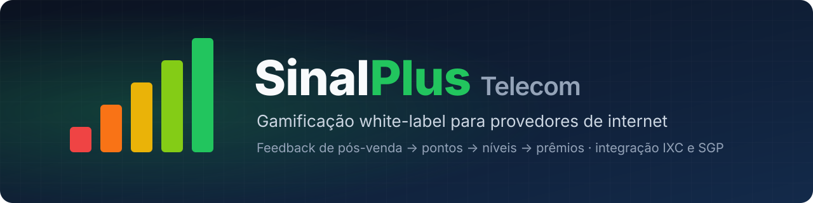
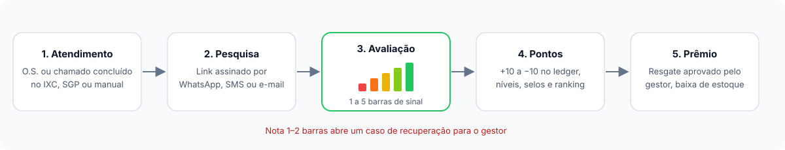
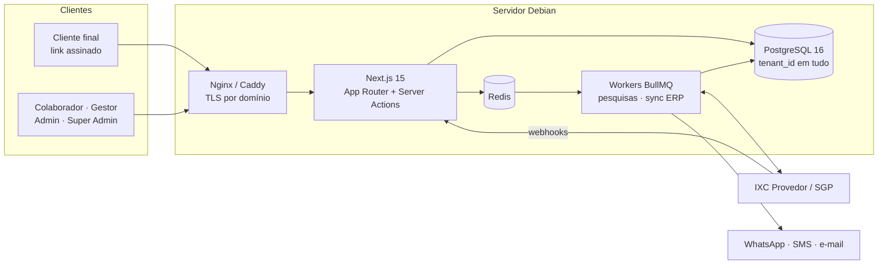

<p align="center">
  
</p>

<p align="center">
  <a href="https://github.com/nicholasrichardsonsecurity/GamificacaoTelecom/actions/workflows/ci.yml"></a>
  
  
  
  
</p>

<p align="center">
  
  
  
  
  
  
  
  
  
  
  
</p>

---

## Sobre o projeto

**SinalPlus** (nome provisório) é um SaaS de gamificação para provedores de
internet (ISPs). Ele transforma o **feedback de pós-venda** em um programa de
**pontos, níveis, selos e prêmios** para quem atende o cliente: técnicos de
instalação, atendentes de suporte e vendedores.

Em vez de estrelas, o cliente avalia o atendimento numa escala de
**sinal de Wi-Fi**, de 1 a 5 barras. Nota alta gera pontos para o colaborador;
nota baixa desconta pontos e abre automaticamente um **caso de recuperação**
para o gestor.

A plataforma nasce **multi-tenant e white-label**: cada provedor tem a própria
marca (logo, cores, nome de exibição, domínio) e os próprios dados, isolados
dos demais. A integração com os ERPs mais usados no setor, **IXC Provedor** e
**SGP**, é prioridade do produto para sincronizar colaboradores e atendimentos
automaticamente em contas grandes.

<p align="center">
  
</p>

## Principais recursos

| | Recurso | Descrição |
|---|---|---|
| 📶 | **Avaliação por sinal** | Escala visual de 1 a 5 barras, respondida por link assinado, sem login do cliente |
| 🏆 | **Pontos, níveis e selos** | Regras de pontuação configuráveis por provedor, níveis por pontuação histórica e conquistas |
| 🎁 | **Catálogo de prêmios** | Prêmios com fotos, estoque e custo em pontos; resgate com aprovação do gestor |
| 🚨 | **Recuperação de serviço** | Nota de 1 ou 2 barras abre um caso com prazo de contato para o gestor |
| 🎨 | **White-label** | Logo, favicon, cores, nome de exibição e domínio próprio por provedor |
| 🔌 | **Conectores IXC e SGP** | Sincronização de colaboradores e atendimentos via interface plugável `ConectorERP` |
| 📊 | **Ranking e painéis** | Visão por colaborador, equipe, filial e período |
| 🧾 | **Ledger imutável** | Saldo calculado pela soma das transações; nada de `UPDATE` em saldo |

### Regra de pontuação padrão

| Avaliação | Pontos |
|:---:|:---:|
| 📶📶📶📶📶 5 barras | **+10** |
| 📶📶📶📶 4 barras | **+5** |
| 📶📶📶 3 barras | 0 |
| 📶📶 2 barras | **−5** |
| 📶 1 barra | **−10** e caso de recuperação |

Cada provedor pode recalibrar esses valores, criar campanhas com multiplicador
e definir limites diários ou semanais.

## Arquitetura



- **Multi-tenancy** por coluna `tenant_id` em banco único, com toda query
  passando por uma camada central que injeta o tenant da sessão.
- **Resolução de tenant por domínio**: `{slug}.sinalplus.com.br` ou domínio
  próprio do provedor, com o branding injetado no layout.
- **RBAC** com os papéis `SUPER_ADMIN`, `ADMIN_PROVEDOR`, `GESTOR` e
  `COLABORADOR`.
- **Webhooks idempotentes** por `origemExternaId` e *upsert* de colaboradores
  por `idExternoERP`.
- **Credenciais de ERP criptografadas** em repouso.

## Como rodar localmente

Pré-requisitos: **Node.js 22+** e **PostgreSQL 16**. Redis só será necessário a
partir da Fase 2 (filas BullMQ).

```bash
# 1. Banco de desenvolvimento
sudo -u postgres psql -c "CREATE USER sinalplus WITH PASSWORD 'sinalplus' CREATEDB;"
sudo -u postgres psql -c "CREATE DATABASE sinalplus OWNER sinalplus;"

# 2. Dependências e variáveis de ambiente
npm install
cp .env.example .env   # preencha AUTH_SECRET e CREDENCIAIS_CHAVE (openssl rand -base64 32)

# 3. Migrations e dados de exemplo
npm run db:migrate
npm run db:seed

# 4. Servidor de desenvolvimento
npm run dev
```

Com `PLATAFORMA_DOMINIO="localhost"`, cada provedor fica em um subdomínio de
`localhost`, que os navegadores já resolvem para a sua máquina:

| Endereço | O que é | Login de exemplo |
|---|---|---|
| http://localhost:3000 | Plataforma (Super Admin) | `admin@sinalplus.local` |
| http://demo.localhost:3000 | Provedor de demonstração "Clube Fibra+" | `admin@demo.local`, `gestor@demo.local`, `colaborador@demo.local` |

A senha de todos os usuários de exemplo é `sinalplus123` (mude com `SEED_SENHA`).

### Scripts

| Comando | Faz |
|---|---|
| `npm run dev` | Servidor de desenvolvimento |
| `npm run build` / `npm start` | Build e servidor de produção |
| `npm run lint` / `npm run typecheck` | ESLint e checagem de tipos |
| `npm test` | Testes (Vitest). Os de isolamento no banco rodam com `TEST_DATABASE_URL` apontando para um banco descartável |
| `npm run db:migrate` | Cria e aplica migrations em desenvolvimento |
| `npm run db:deploy` | Aplica migrations em produção |
| `npm run db:seed` | Planos, Super Admin e provedor de demonstração |

### Estrutura

```
prisma/
├── schema.prisma          # modelo de dados (docs/03-MODELO-DADOS.md)
├── migrations/            # inclui CHECKs, índices parciais e o trigger do ledger
└── seed.ts
src/
├── app/
│   ├── (auth)/login/      # login com a marca do provedor
│   ├── (app)/             # área logada: superadmin, admin, gestor, colaborador
│   └── api/auth/          # Auth.js
├── auth.ts / auth.config.ts
├── middleware.ts          # resolução de host + RBAC por área
├── components/            # shadcn/ui e o ícone de sinal
└── lib/
    ├── host.ts            # subdomínio ou domínio próprio → tenant
    ├── tenant.ts          # busca do tenant e branding
    ├── tenant-db.ts       # Prisma escopado por tenant (isolamento)
    ├── rbac.ts            # papéis e áreas
    ├── branding.ts        # cores da marca sanitizadas e contraste
    └── crypto.ts          # credenciais de IXC/SGP cifradas (AES-256-GCM)
```

### Garantias da Fase 0

- **Isolamento por tenant**: `dbDoTenant(tenantId)` injeta o tenant em toda
  leitura e escrita e recusa gravar em outro tenant; testado contra um Postgres real.
- **Login por domínio**: o e-mail é único por provedor, então o tenant vem do
  domínio acessado. Na plataforma só entra `SUPER_ADMIN`.
- **Ledger imutável no banco**: um trigger bloqueia `UPDATE` e `DELETE` em
  `TransacaoPontos`.
- **White-label sem marca fixa**: nome, logo, favicon e cores vêm do `Tenant`;
  cores passam por validação antes de virarem CSS.

## Roadmap

| Fase | Entrega | Status |
|:---:|---|:---:|
| 0 | Fundação técnica: Next.js, Prisma, schema com white-label, Auth.js + RBAC, resolução de tenant | ✅ |
| 1 | Núcleo de negócio (MVP): tenants, branding, usuários, regras, avaliação por sinal, motor de pontuação, ranking | 🚧 |
| 2 | Conectores de ERP IXC e SGP: sincronização periódica e webhooks | ⏳ |
| 3 | Prêmios e resgate com fotos, aprovação e baixa de estoque | ⏳ |
| 4 | Notificações (WhatsApp, e-mail, SMS) e campanhas de pontos | ⏳ |
| 5 | White-label avançado: onboarding self-service, domínio próprio com HTTPS automático | ⏳ |
| 6 | Deploy em produção no Debian e backups | ⏳ |

O detalhamento de cada fase está em [`CLAUDE.md`](CLAUDE.md).

## Documentação

| Documento | Conteúdo |
|---|---|
| [`CLAUDE.md`](CLAUDE.md) | Instruções mestras, convenções de engenharia e roadmap por fase |
| [`docs/01-FUNDACAO-PRODUTO.md`](docs/01-FUNDACAO-PRODUTO.md) | Problema, visão, personas, fluxos, regras de pontuação, white-label e integrações |
| [`docs/02-ARQUITETURA-STACK.md`](docs/02-ARQUITETURA-STACK.md) | Stack, estrutura de pastas, multi-tenancy, RBAC e conectores de ERP |
| [`docs/03-MODELO-DADOS.md`](docs/03-MODELO-DADOS.md) | Entidades, índices e cálculo de saldo |
| [`docs/04-DEPLOY-DEBIAN.md`](docs/04-DEPLOY-DEBIAN.md) | Passo a passo de produção em Debian 12 com PM2, Nginx e Certbot |
| [`docs/REFERENCIA-IXC-SGP.md`](docs/REFERENCIA-IXC-SGP.md) | Guia de consulta sobre as APIs do IXC Provedor e do SGP: links oficiais, autenticação, endpoints já mapeados e checklist do que falta confirmar antes de implementar os conectores da Fase 2 |

## Fora de escopo nesta versão

Pagamento de bônus em dinheiro, app mobile nativo (o MVP usa PWA), conectores
para ERPs além de IXC e SGP, e cobrança self-service automatizada.

## Licença

Projeto de **uso pessoal e restrito** — ver [`LICENSE.md`](LICENSE.md). Uso
comercial, testes por terceiros e redistribuição não são permitidos sem
autorização expressa e por escrito do autor.

---

<p align="center">
  Feito para provedores de internet do Brasil 🇧🇷
</p>
