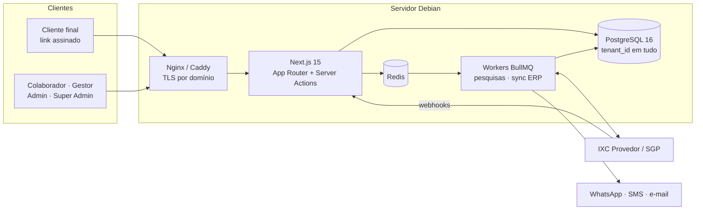

  

  
  
  
  

  
  
  
  
  
  
  
  
  
  
  

---

## Sobre o projeto

**SinalPlus** (nome provisório) é um SaaS de gamificação para provedores de
internet (ISPs). Ele transforma o **feedback de pós-venda** em um programa de
**pontos, níveis, selos e prêmios** para quem atende o cliente: técnicos de
instalação, atendentes de suporte e vendedores.

Em vez de estrelas, o cliente avalia o atendimento numa escala de
**sinal de Wi-Fi**, de 1 a 5 barras. Nota alta gera pontos para o colaborador;
nota baixa desconta pontos e abre automaticamente um **caso de recuperação**
para o gestor.

A plataforma nasce **multi-tenant e white-label**: cada provedor tem a própria
marca (logo, cores, nome de exibição, domínio) e os próprios dados, isolados
dos demais. A integração com os ERPs mais usados no setor, **IXC Provedor** e
**SGP**, é prioridade do produto para sincronizar colaboradores e atendimentos
automaticamente em contas grandes.

  

## Principais recursos

| | Recurso | Descrição |
|---|---|---|
| 📶 | **Avaliação por sinal** | Escala visual de 1 a 5 barras, respondida por link assinado, sem login do cliente |
| 🏆 | **Pontos, níveis e selos** | Regras de pontuação configuráveis por provedor, níveis por pontuação histórica e conquistas |
| 🎁 | **Catálogo de prêmios** | Prêmios com fotos, estoque e custo em pontos; resgate com aprovação do gestor |
| 🚨 | **Recuperação de serviço** | Nota de 1 ou 2 barras abre um caso com prazo de contato para o gestor |
| 🎨 | **White-label** | Logo, favicon, cores, nome de exibição e domínio próprio por provedor |
| 🔌 | **Conectores IXC e SGP** | Sincronização de colaboradores e atendimentos via interface plugável `ConectorERP` |
| 📊 | **Ranking e painéis** | Visão por colaborador, equipe, filial e período |
| 🧾 | **Ledger imutável** | Saldo calculado pela soma das transações; nada de `UPDATE` em saldo |

### Regra de pontuação padrão

| Avaliação | Pontos |
|:---:|:---:|
| 📶📶📶📶📶 5 barras | **+10** |
| 📶📶📶📶 4 barras | **+5** |
| 📶📶📶 3 barras | 0 |
| 📶📶 2 barras | **−5** |
| 📶 1 barra | **−10** e caso de recuperação |

Cada provedor pode recalibrar esses valores, criar campanhas com multiplicador
e definir limites diários ou semanais.

## Arquitetura

- **Multi-tenancy** por coluna `tenant_id` em banco único, com toda query
  passando por uma camada central que injeta o tenant da sessão.
- **Resolução de tenant por domínio**: `{slug}.sinalplus.com.br` ou domínio
  próprio do provedor, com o branding injetado no layout.
- **RBAC** com os papéis `SUPER_ADMIN`, `ADMIN_PROVEDOR`, `GESTOR` e
  `COLABORADOR`.
- **Webhooks idempotentes** por `origemExternaId` e *upsert* de colaboradores
  por `idExternoERP`.
- **Credenciais de ERP criptografadas** em repouso.

## Roadmap

| Fase | Entrega | Status |
|:---:|---|:---:|
| 0 | Fundação técnica: Next.js, Prisma, schema com white-label, Auth.js + RBAC, resolução de tenant | 🚧 |
| 1 | Núcleo de negócio (MVP): tenants, branding, usuários, regras, avaliação por sinal, motor de pontuação, ranking | ⏳ |
| 2 | Conectores de ERP IXC e SGP: sincronização periódica e webhooks | ⏳ |
| 3 | Prêmios e resgate com fotos, aprovação e baixa de estoque | ⏳ |
| 4 | Notificações (WhatsApp, e-mail, SMS) e campanhas de pontos | ⏳ |
| 5 | White-label avançado: onboarding self-service, domínio próprio com HTTPS automático | ⏳ |
| 6 | Deploy em produção no Debian e backups | ⏳ |

O detalhamento de cada fase está em [`CLAUDE.md`](CLAUDE.md).

## Documentação

| Documento | Conteúdo |
|---|---|
| [`CLAUDE.md`](CLAUDE.md) | Instruções mestras, convenções de engenharia e roadmap por fase |
| [`docs/01-FUNDACAO-PRODUTO.md`](docs/01-FUNDACAO-PRODUTO.md) | Problema, visão, personas, fluxos, regras de pontuação, white-label e integrações |
| [`docs/02-ARQUITETURA-STACK.md`](docs/02-ARQUITETURA-STACK.md) | Stack, estrutura de pastas, multi-tenancy, RBAC e conectores de ERP |
| [`docs/03-MODELO-DADOS.md`](docs/03-MODELO-DADOS.md) | Entidades, índices e cálculo de saldo |
| [`docs/04-DEPLOY-DEBIAN.md`](docs/04-DEPLOY-DEBIAN.md) | Passo a passo de produção em Debian 12 com PM2, Nginx e Certbot |

## Fora de escopo nesta versão

Pagamento de bônus em dinheiro, app mobile nativo (o MVP usa PWA), conectores
para ERPs além de IXC e SGP, e cobrança self-service automatizada.

---

  Feito para provedores de internet do Brasil 🇧🇷

